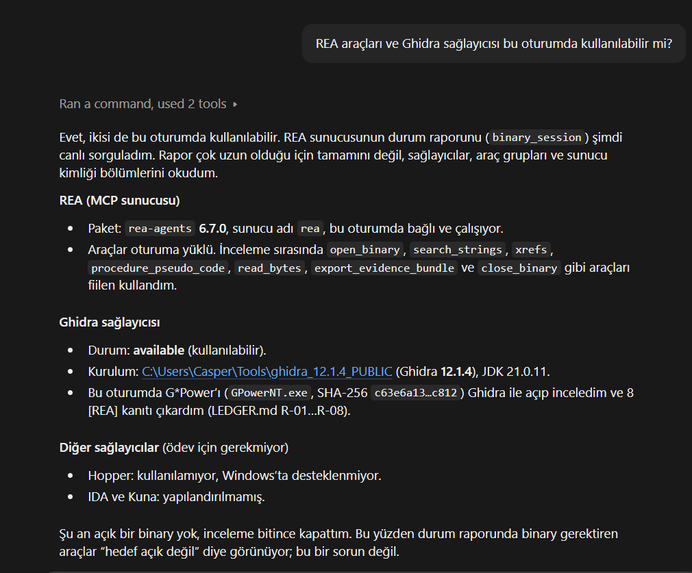

# gpower-clone · `t2-indep`

**YZM301 · Teardown Sprint** · Aile: **t testi, iki bağımsız ortalama (ilaç ve plasebo)** · Sözleşme sürümü 1.0.0

> **Yapılan katmanlar:** ✅ CLI (temel) · ✅ MCP sunucusu (+15) · ✅ AI ajanı (+10, MCP üzerinden, Türkçe)
> Modlar: ✅ a-priori ✅ post-hoc ✅ compromise ✅ criterion ✅ sensitivity

Bu proje, G*Power'ın bir hesabını, iki bağımsız grubun ortalamalarını karşılaştıran t testini, temiz odada yeniden yazar ve ajanların az token harcayarak kullanabileceği bir CLI, MCP sunucusu ve ajanın arkasına koyar. **Bu yazılım G*Power değildir ve G*Power olarak sunulmaz.**

## Kurulum ve çalıştırma

Gerekenler: [uv](https://docs.astral.sh/uv/) (Python'u kendisi kurar). Motorun çalışma zamanı bağımlılığı yoktur (yalnızca Python standart kütüphanesi).

```bash
uv tool install .
```

```bash
gpower-clone --test t2-indep --mode a-priori --tails 2 --d 0.5 --alpha 0.05 --power 0.95 --ratio 1
```
```json
{"ncp": 3.6228441865473595, "critical_t": 1.9714346585202427, "df": 208, "n1": 105, "n2": 105, "n_total": 210, "actual_power": 0.9501287033887206}
```

Kurmadan, repo içinden tek komut: `uv run gpower-clone --test t2-indep --mode post-hoc --tails 1 --d 0.5 --alpha 0.05 --n1 88 --n2 88`

```bash
gpower-clone --version
```
```json
{"contract_version": "1.0.0", "name": "gpower-clone-t2indep", "engine": "Python 3.12.15 (stdlib)"}
```

- Çıktı stdout'a **tek satır JSON**; hata: `{"error", "code", "field"}`, çıkış kodu 2 (geçersiz girdi) ya da 1 (çözüm yok / iç hata).
- Bir çağrı yaklaşık 0.16 s sürer (sınır 2 s). Diğer test aileleri `UNSUPPORTED` döner.

### Testler

```bash
uv sync --all-extras --group dev
```
```bash
uv run pytest -q
```

1050'den fazla test: açık vektörler, SPEC'teki Gherkin kabul kriterleri, SciPy'ye karşı sayısal doğruluk, değişmezler, girdi doğrulama, CLI, MCP ≡ CLI eşdeğerliği, ajan döngüsü ve 600 statsmodels vektörüyle diferansiyel test. Uyum raporu: [tests/AGREEMENT_REPORT.md](tests/AGREEMENT_REPORT.md) (`uv run python tools/differential_report.py`).

## MCP sunucusu

```bash
gpower-clone-mcp
```

Stdio üzerinden tek araç: **`power_analysis`**. Çıktı, CLI'nin stdout satırıyla bayt bayt aynıdır (`tests/test_mcp_equivalence.py`, 25 vektör + hata girdileri). Hata durumunda aynı hata JSON'u `isError: true` ile döner. Hesap MCP katmanında değil, motordadır.

**Girdi şeması** (alan adları CLI ile aynı; `test` ve `mode` zorunlu, diğerlerinin zorunluluğu moda göre motor tarafından denetlenir; tür hatalarını da motor raporlar):

| Alan | Tür | Açıklama | Hangi modlarda |
|---|---|---|---|
| `test` | string | `t2-indep` | hepsi |
| `mode` | string | `a-priori`, `post-hoc`, `compromise`, `criterion`, `sensitivity` | hepsi |
| `tails` | 1 \| 2 | Tek ya da çift kuyruk | hepsi |
| `d` | number > 0 | Cohen d | sensitivity hariç |
| `alpha` | 0 < number < 1 | I. tip hata | a-priori, post-hoc, sensitivity |
| `power` | 0 < number < 1 | Hedef güç | a-priori, criterion, sensitivity |
| `ratio` | number > 0 | N2/N1 | a-priori |
| `n1`, `n2` | integer ≥ 2 | Grup büyüklükleri | a-priori hariç |
| `beta_alpha_ratio` | number > 0 | β/α | compromise |

**Çıktı şeması:**

| Mod | Alanlar |
|---|---|
| a-priori | `ncp, critical_t, df, n1, n2, n_total, actual_power` |
| post-hoc | `ncp, critical_t, df, power` |
| compromise | `ncp, critical_t, df, alpha, beta, power` |
| criterion | `ncp, critical_t, df, alpha` |
| sensitivity | `ncp, critical_t, df, d` |

Claude Code'a ekleme örneği: `claude mcp add gpower-clone -- gpower-clone-mcp`

## AI ajanı

```bash
gpower-clone-agent "İlaç ile plaseboyu karşılaştıracağız, d = 0.5, iki yönlü, alfa 0.05, güç %80. Her gruba kaç hasta?"
```

Bir `ANTHROPIC_API_KEY` ortam değişkeni gerekir. Ajan MCP aracını çağırır ve **hesabı asla kendisi yapmaz**. "Orta etki" gibi bir kategoriyi sessizce değere çevirmez. Her araç çağrısı `logs/agent_calls.jsonl`'a yazılır. 10 soruluk değerlendirme seti ve MCP ↔ GUI token karşılaştırması: [eval/](eval/) (`uv run --all-extras python eval/run_eval.py`). Yalnızca kurgusal senaryolar kullanılır.

## Teslim belgeleri

| Belge | İçerik |
|---|---|
| [SPEC.md](SPEC.md) | Temiz oda belirtimi; kabul kriterleri Gherkin biçiminde (testlerle doğrudan çalıştırılır) |
| [LEDGER.md](LEDGER.md) | Kanıt defteri: `[DOK]`, `[REA]`, `[AJAN]` |
| [HALLUCINATIONS.md](HALLUCINATIONS.md) | Ajanların yanlış çıkardığı 6 şey, nasıl ve hangi testle yakalandığı |
| [AGENT_COST.md](AGENT_COST.md) | Ajanlar, token, iterasyonlar, neyi farklı yapardık |
| [prompts/](prompts/) | İki oturumun ilk prompt'ları |
| [oracle/](oracle/) | G*Power vektörleri (CSV) ve ekran görüntüleri; 600 statsmodels ölçek vektörü |
| [tests/](tests/) | Diferansiyel test ve [uyum raporu](tests/AGREEMENT_REPORT.md) |
| [docs/CLEANROOM.md](docs/CLEANROOM.md) | Temiz oda süreci ve "doğru olduğunu nasıl kanıtlarız?" |
| [docs/IMPLEMENTATION_NOTES.md](docs/IMPLEMENTATION_NOTES.md) | Yazım oturumunun notları: sayısal yöntemler, SPEC belirsizlikleri |

## Referans ve sürüm bilgisi

| | |
|---|---|
| Kâhin | G*Power 3.1.9.7 (Windows), yalnızca resmi sayfadan: [psychologie.hhu.de › G*Power](https://www.psychologie.hhu.de/arbeitsgruppen/allgemeine-psychologie-und-arbeitspsychologie/gpower) |
| `GPowerNT.exe` SHA-256 | `c63e6a133eb6372932f810c08cc33dc35a06d1ddb658f897bd6c34a754efc812` |
| İnceleme araçları | REA (`rea-agents` 6.7.0), Ghidra 12.1.4, JDK 21.0.11 |
| GPower.exe repoda | Hayır (`.gitignore`). Teslim edilen kodda decompile çıktısı yok. |

REA kontrolü ("REA araçları ve Ghidra sağlayıcısı bu oturumda kullanılabilir mi?"):



Demo (60 saniye, CLI): _video bağlantısı eklenecek_

## Atıf

G*Power'ın yazarları bu aracı bilim dünyasına ücretsiz sundu. Bu çalışma onların emeğine saygıyla, yalnızca eğitim amacıyla yapıldı:

- Faul, F., Erdfelder, E., Lang, A.-G., & Buchner, A. (2007). G*Power 3: A flexible statistical power analysis program for the social, behavioral, and biomedical sciences. *Behavior Research Methods, 39*, 175–191.
- Faul, F., Erdfelder, E., Buchner, A., & Lang, A.-G. (2009). Statistical power analyses using G*Power 3.1: Tests for correlation and regression analyses. *Behavior Research Methods, 41*, 1149–1160.
- Cohen, J. (1988). *Statistical power analysis for the behavioral sciences* (2nd ed.). Lawrence Erlbaum.
- Lenth, R. V. (1989). Algorithm AS 243: Cumulative distribution function of the non-central t distribution. *Applied Statistics, 38*, 185–189.
